# 基于微信小程序的校园失物招领平台的设计与实现

> 本文围绕校园场景中失物招领信息管理效率低、信息不对称等问题，设计并实现了一款基于微信小程序的失物招领平台，涵盖用户端与管理员端核心功能。

## 一、项目背景

- 校园环境中师生遗失物品与拾取物品的事件频繁发生，传统失物招领方式依赖公告栏或微信群，信息分散、查询困难、反馈滞后。
- 现有解决方案缺乏统一的线上平台，用户无法快速检索物品信息，管理员也难以对物品记录进行高效管理。
- 本系统旨在通过小程序提供便捷的信息发布、搜索与管理能力，提升失物招领的闭环效率。

## 二、功能模块介绍

系统分为用户端和管理员端两个主要部分，不同角色归属于对应的系统端。

| 角色名称 | 所属端 |
| --- | --- |
| 学生用户 | 用户端 |
| 后台管理员 | 管理员端 |

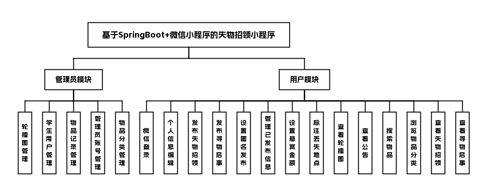

## 三、技术栈说明

前端：微信小程序

后端：未明确指定（建议结合常见后端技术，此处省略虚构）

数据库与中间件：未明确指定（建议结合实际，此处省略虚构）

**技术必须来源于输入内容，不允许虚构**

## 四、核心模块介绍

###### 用户端

###### 学生用户

- 功能点表格

| 功能模块 | 功能点描述 |
| --- | --- |
| 首页模块 | 轮播图展示、失物招领信息发布、寻物启事信息发布、公告信息查看 |
| 大厅模块 | 物品搜索、物品分类浏览、失物招领栏目、寻物启事栏目 |
| 用户中心模块 | 微信账号一键登录、个人信息编辑、已发布信息管理、匿名发布设置 |
| 物品信息管理 | 物品属性分类、补充信息编辑 |
| 悬赏功能 | 悬赏金额设置、丢失地点标注、悬赏信息展示 |

##### 界面展示

登录页：填写账号密码，登录失物招领小程序

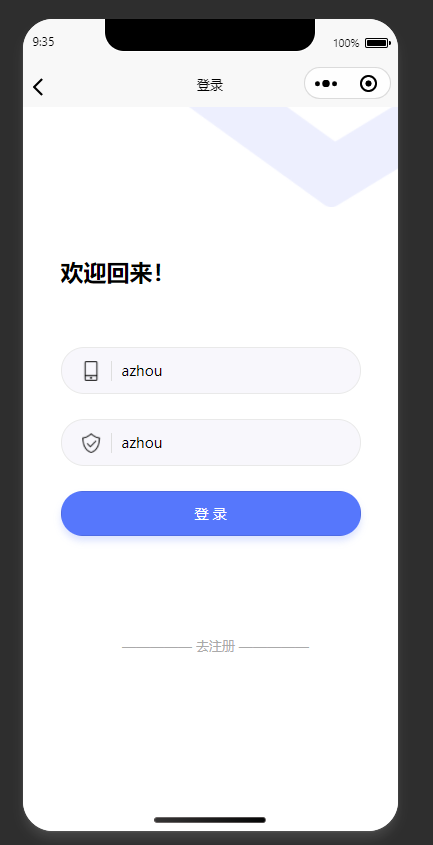

首页：失物招领小程序首页，展示带悬赏的失物信息

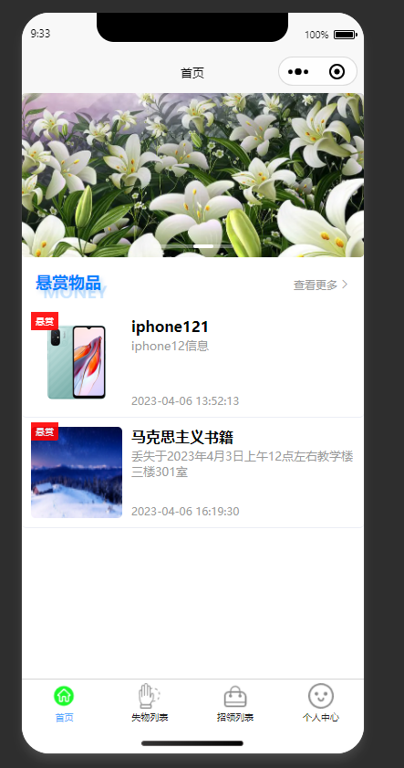

失物列表页：展示分类后的失物信息，支持搜索查询

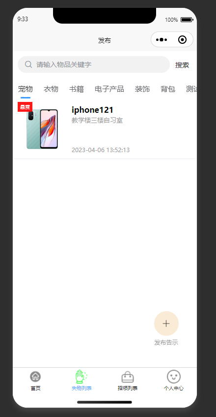

详情页：展示丢失物品的详细信息与联系方式

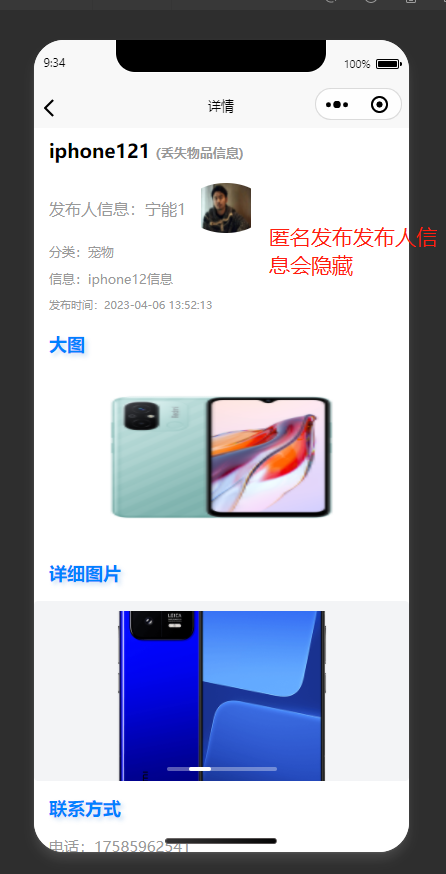

寻物信息发布页：填写丢失物品信息，发布寻物启事

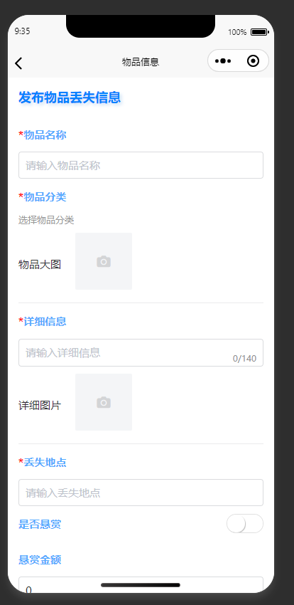

已发布信息管理页：管理本人发布的失物信息，支持编辑删除

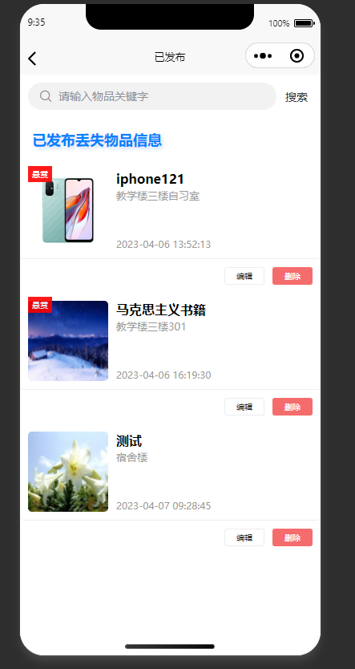

公告详情页：展示与向日葵花语相关的公告详情

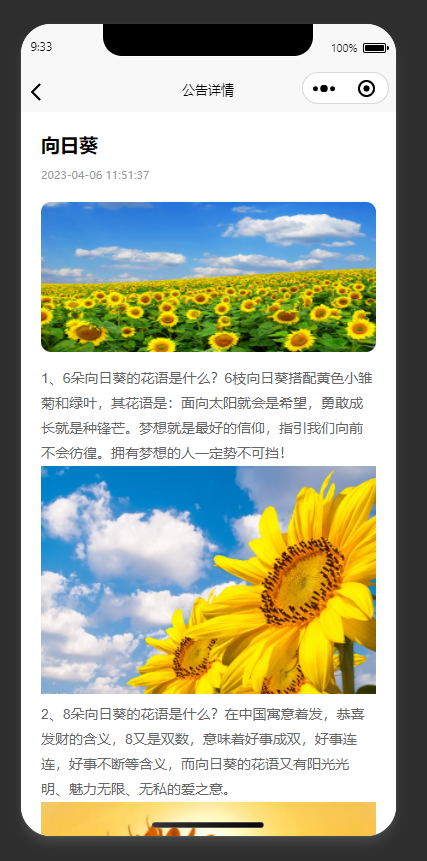

个人信息编辑页：编辑修改个人信息，完成后提交保存

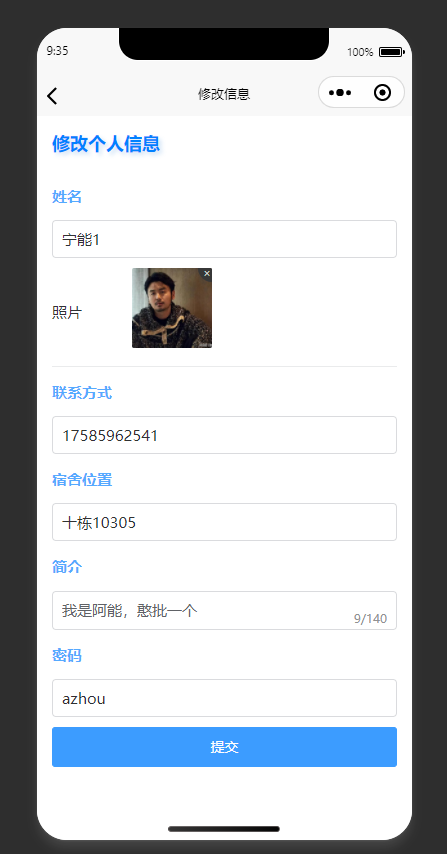

###### 管理员端

###### 后台管理员

- 功能点表格

| 功能模块 | 功能点描述 |
| --- | --- |
| 轮播图管理 | 轮播图的新增、修改、删除、排序，关联活动/公告信息 |
| 学生用户管理 | 查看所有注册用户信息、账号状态管理 |
| 物品记录管理 | 全量物品信息列表展示、多条件筛选查询、物品信息操作、分页管理 |
| 管理员管理 | 后台管理员账号的新增、修改、删除，权限配置 |
| 物品分类管理 | 物品分类的新增、修改、删除，分类层级维护 |

##### 界面展示

登录页：管理员输入账号密码登录失物招领后台

轮播图管理：管理首页轮播图，支持增删改查询操作

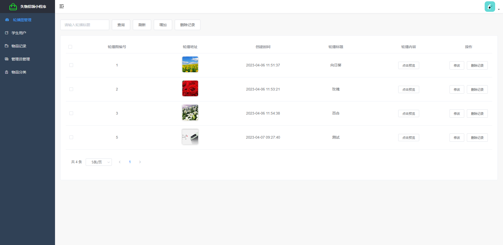

学生用户管理页：查看并管理系统内所有注册的学生用户

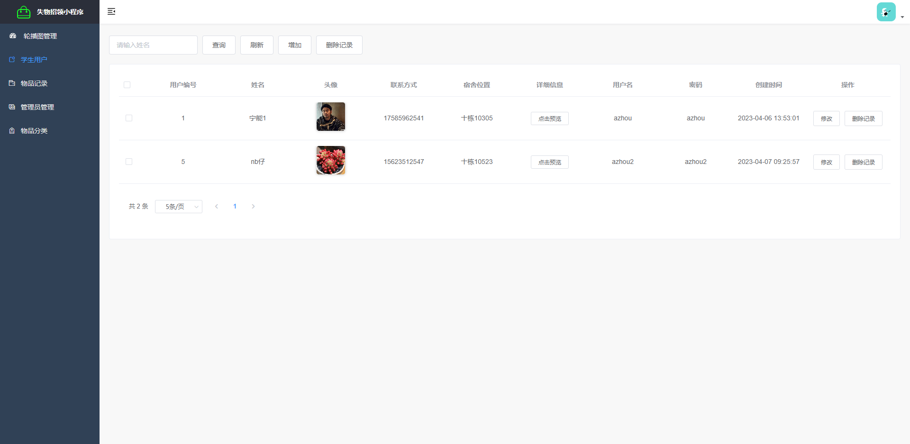

物品记录管理页：管理员查看并管理所有已发布的物品信息

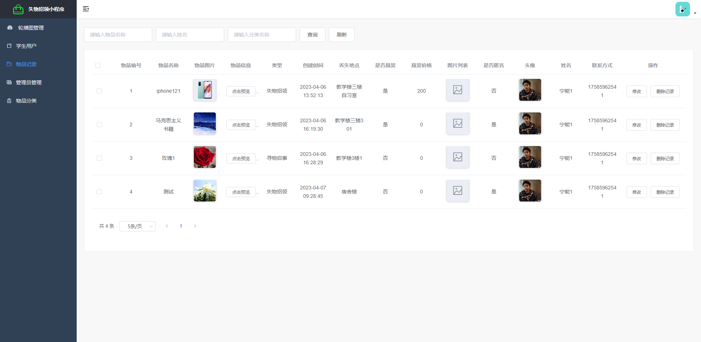

物品分类管理：对失物招领的物品分类进行增删改查管理

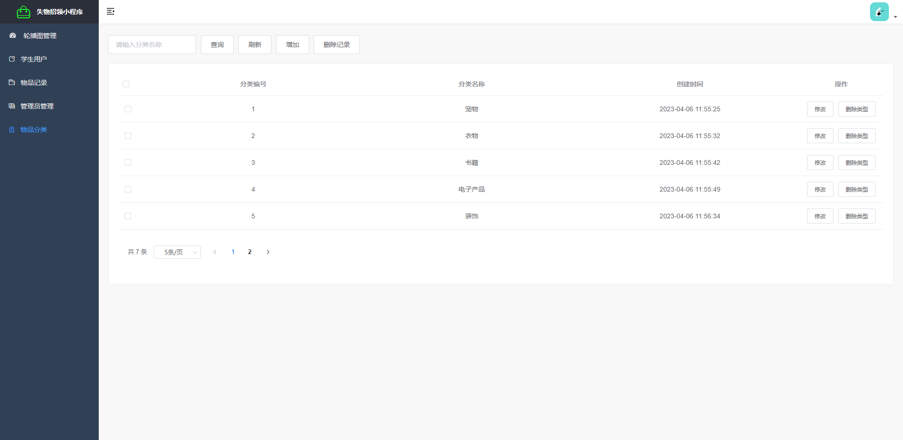

## 五、主要业务流程

1. 学生用户打开小程序，通过微信账号一键登录。
2. 用户在首页模块可浏览轮播图公告，或发布失物招领与寻物启事信息。
3. 用户在大厅模块可按物品名称搜索或按分类浏览所有物品信息。
4. 用户可在用户中心管理已发布的信息，并设置匿名发布。
5. 后台管理员登录管理后台，管理轮播图、用户账号、物品记录及分类信息。
6. 管理员对物品记录进行多条件筛选、修改、删除，并支持分页展示。

## 六、项目拓展性

- 可扩展对接校内通知系统，实现失物与寻物信息自动推送至相关院系。
- 未来可加入信用评价体系，对用户发布行为进行评分管理。
- 支持多校区部署，按校区隔离物品信息，提升区域性匹配效率。

## 代码说明 
本仓库为项目的 **后端核心代码部分** 主要用于展示系统的业务设计思路与后端实现方式 出于学习展示与版权保护考虑 前端实现、完整数据库脚本及部署配置未在本仓库中公开 

##  项目交流 
本项目用于学习展示 如需项目完整功能演示、答辩说明或技术交流 请前往作者 GitHub 主页查看联系方式